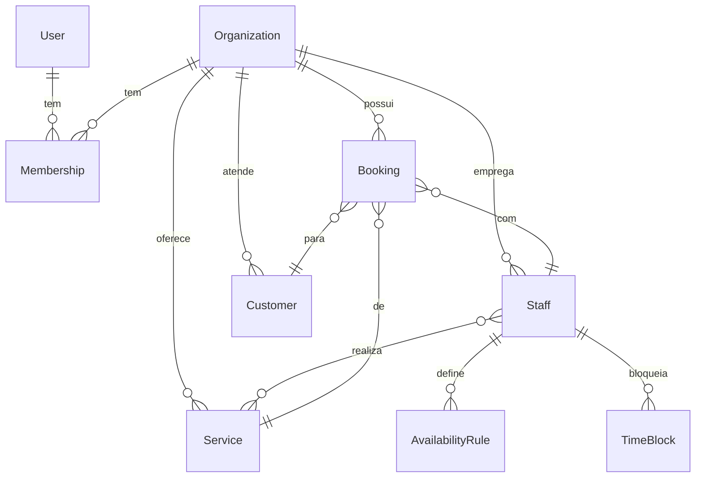

# AgendaFlow AI

SaaS de agendamento para barbearias e profissionais de beleza. Os clientes reservam por uma página pública, sem criar conta, e o dono acompanha agenda e indicadores num painel.

> **Status: Fase 3 concluída.** O produto já funciona de ponta a ponta: o dono cadastra serviços, profissionais e jornada; o cliente reserva pela página pública; o dono acompanha agenda e indicadores. Assinaturas, lembretes e IA ainda **não** foram implementados. Veja o [roadmap](#roadmap).

## O que já funciona
- **Painel do dono** (`/painel`): indicadores do dia e do mês (atendimentos, faturamento, taxa de faltas, clientes novos), próximos horários, checklist de configuração e link da página de reservas.
- **Serviços**: nome, duração, preço e descrição; pausar e reativar.
- **Profissionais**: serviços que cada um realiza, jornada semanal com pausa de almoço, folgas e bloqueios pontuais.
- **Agenda** (`/painel/agenda`): navegação por dia, filtro por profissional, link direto para o WhatsApp do cliente, ações de concluir, marcar falta, cancelar e reativar.
- **Página pública** (`/agendar/<slug>`): o cliente escolhe serviço, profissional (ou "sem preferência"), dia e horário, e informa nome e WhatsApp com consentimento LGPD. Não precisa criar conta.

## Stack
Next.js (App Router) · React · TypeScript · Tailwind CSS · PostgreSQL · Prisma · Better Auth · Zod · Vitest

## Como rodar
Requisitos: Node 22+ e Docker **ou** o banco embutido do projeto.

```bash
npm install
cp .env.example .env        # preencha BETTER_AUTH_SECRET (openssl rand -base64 32)
docker compose up -d        # ou: npm run db:dev (PostgreSQL embutido, sem Docker)
npx prisma migrate dev
npm run dev
```

## Testes
```bash
npm test            # unitários e integração (precisa do banco rodando)
npm run lint && npm run typecheck && npm run build
```
```bash
npm run build && npm run test:e2e   # E2E com Playwright (desktop e celular), sobe o servidor sozinho
```
Cobrem:
- **Horários livres**: jornada, pausa, bloqueios, antecedência mínima, fuso e horário de verão.
- **Reserva duplicada**: 20 reservas simultâneas no banco e 10 clientes disputando o mesmo horário pela página pública: só 1 é aceita.
- **Isolamento entre empresas**: uma empresa não altera serviços, profissionais, jornadas, bloqueios nem reservas de outra.
- **Regras da reserva**: horário fora da jornada é recusado (o servidor não confia no navegador), "sem preferência" distribui entre profissionais, cliente é reaproveitado pelo telefone.
- **E2E**: cadastro, configuração, reserva pública, confirmação e cancelamento na agenda, em desktop e celular.

## Decisões de arquitetura
- **Monólito modular**: `src/modules/<dominio>` com `actions` (entrada), `service` (regra de negócio), `schema` (Zod).
- **Multi-tenant**: toda tabela de negócio tem `organizationId`. O id da organização vem sempre da sessão no servidor (`requireOrg()`), nunca do cliente.
- **Sem reserva duplicada**: *exclusion constraint* do PostgreSQL por profissional (`prisma/migrations/*booking_no_overlap`). A garantia é do banco, então vale sob concorrência.
- **Horários em UTC**, com o fuso da organização guardado à parte (`America/Sao_Paulo` por padrão).
- **Valores em centavos** (inteiros).
- **Horários livres calculados por função pura** (`src/modules/availability/slots.ts`), testada sem banco. Na reserva, o servidor recalcula a grade e só aceita horários que estão nela.
- **Formulários com Server Actions** e `useActionState`; o `organizationId` nunca vem do formulário.

## Modelo de dados


## Roadmap
- [x] Fase 1: planejamento
- [x] Fase 2: fundação (auth, organização, banco, CI)
- [x] Fase 3: serviços, profissionais, disponibilidade, agenda, página pública, dashboard
- [ ] Fase 4: segurança (rate limit, headers), acessibilidade, lembretes por WhatsApp (E2E básico já existe)
- [ ] Fase 5: landing, assinaturas, deploy
- [ ] Fase 6: IA
- [ ] Fase 7: documentação final e demonstração

## Licença
Código-fonte disponível para avaliação, **não** livre para uso comercial. Veja [LICENSE](LICENSE).
