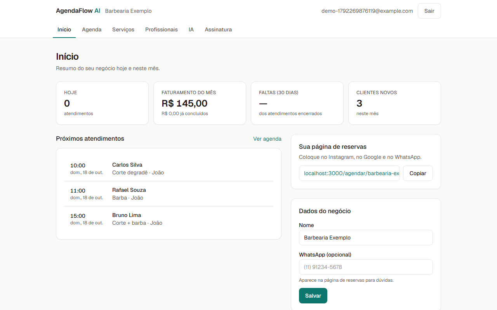
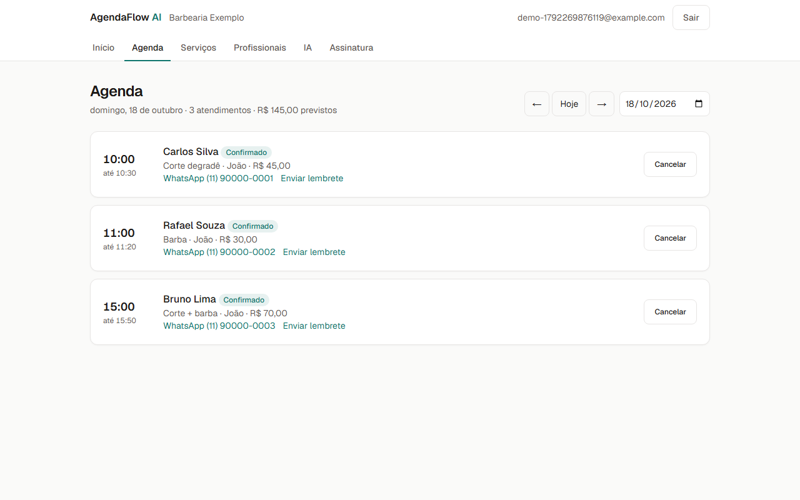
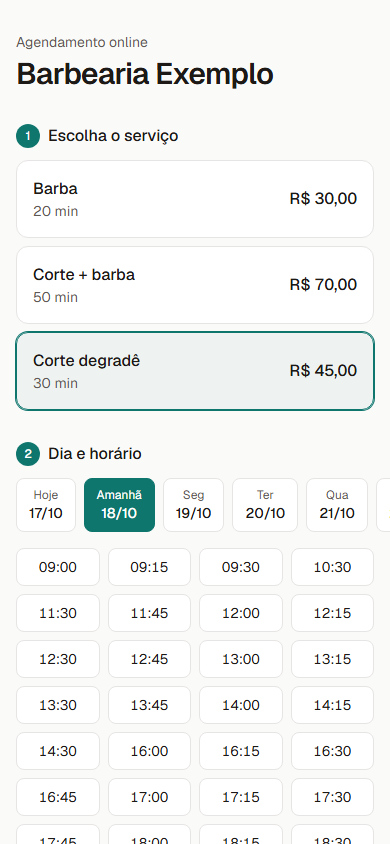
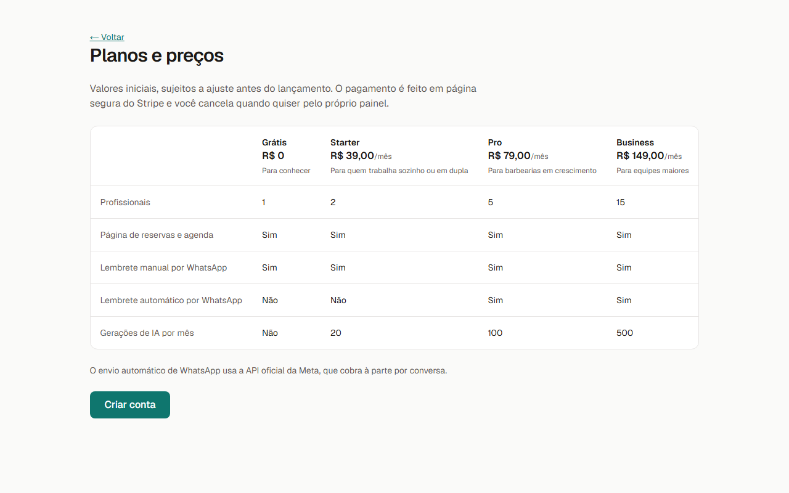
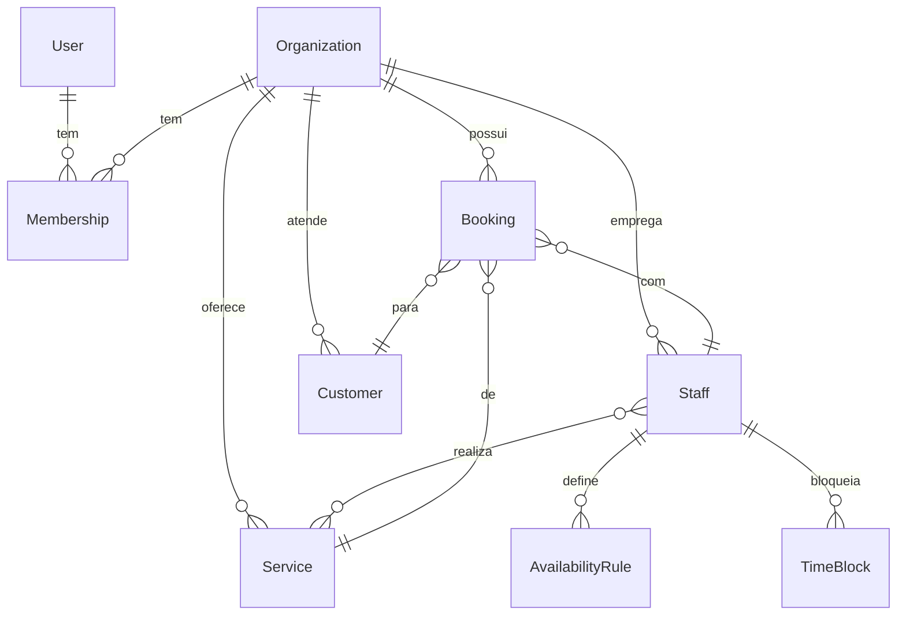

# AgendaFlow AI

SaaS de agendamento para barbearias e profissionais de beleza. Os clientes reservam por uma página pública, sem criar conta, e o dono acompanha agenda e indicadores num painel.

> **Status: código das Fases 1 a 6 escrito e testado; ainda não está no ar.** O núcleo (reservas, agenda, painel, lembretes) foi exercitado de ponta a ponta nos testes automatizados. A **cobrança com Stripe** e a **IA** estão implementadas e testadas com simulações, mas **ainda não foram verificadas contra o Stripe nem contra o provedor de IA reais**, porque dependem de contas e chaves. Também falta o deploy. Veja [o que falta](#o-que-falta-antes-de-vender).

## Capturas de tela

| Painel | Agenda |
|---|---|
|  |  |

| Reserva no celular | Planos |
|---|---|
|  |  |

Dados de demonstração (negócio fictício) gerados por `npm run screenshots`.

## O que já funciona
- **Painel do dono** (`/painel`): indicadores do dia e do mês (atendimentos, faturamento, taxa de faltas, clientes novos), próximos horários, checklist de configuração e link da página de reservas.
- **Serviços**: nome, duração, preço e descrição; pausar e reativar.
- **Profissionais**: serviços que cada um realiza, jornada semanal com pausa de almoço, folgas e bloqueios pontuais.
- **Agenda** (`/painel/agenda`): navegação por dia, filtro por profissional, link direto para o WhatsApp do cliente, ações de concluir, marcar falta, cancelar e reativar.
- **Página pública** (`/agendar/<slug>`): o cliente escolhe serviço, profissional (ou "sem preferência"), dia e horário, e informa nome e WhatsApp com consentimento LGPD. Não precisa criar conta.
- **Link da reserva** (`/agendar/<slug>/reserva/<token>`): link secreto onde o cliente vê e cancela o próprio horário, liberando a vaga. Vai no lembrete.
- **Lembretes por WhatsApp**, de dois jeitos:
  - **Sem configurar nada:** na agenda, o botão "Enviar lembrete" abre o WhatsApp do dono com a mensagem pronta.
  - **Automático:** `GET /api/cron/lembretes` (de hora em hora, via `vercel.json`) envia pela WhatsApp Cloud API para quem tem horário nas próximas 24 h. Não envia duas vezes, mesmo com execuções simultâneas, e tenta de novo se falhar.

### Configurar o envio automático
1. Crie um app na Meta for Developers com WhatsApp e pegue o token e o *Phone number ID*.
2. Crie e aprove o template `lembrete_agendamento` (pt_BR) com 5 variáveis no corpo:
   `Olá, {{1}}! Lembrete do seu horário em {{2}}: {{3}}, {{4}}. Se não puder vir, cancele aqui: {{5}}`
3. Preencha `WHATSAPP_TOKEN`, `WHATSAPP_PHONE_NUMBER_ID`, `WHATSAPP_REMINDER_TEMPLATE` e `CRON_SECRET` no `.env`.

### Planos e assinatura
- **Planos** (`src/modules/billing/plans.ts`): Grátis, Starter R$ 39, Pro R$ 79 e Business R$ 149 por mês. Preços e limites ficam num arquivo só e são hipóteses iniciais.
- **Limites por plano**: número de profissionais, lembrete automático por WhatsApp e gerações de IA por mês.
- **Cobrança só liga com o Stripe configurado.** Sem `STRIPE_SECRET_KEY`, tudo é gratuito e sem limite de profissionais (fase de lançamento), e a tela de assinatura avisa isso.
- **Checkout e portal** são páginas do Stripe: o sistema nunca vê nem guarda dados de cartão. O cliente troca cartão e cancela pelo portal.
- **Webhook** (`POST /api/webhooks/stripe`): confere a assinatura do Stripe, processa cada evento uma única vez (mesmo com entregas simultâneas) e desfaz tudo se algo falhar, para o Stripe reenviar. Pagamento falho mantém o plano e mostra aviso; cancelamento volta para o Grátis.

### Assistente de IA (`/painel/ia`)
- **Resumo dos últimos 30 dias**, **ideias para ocupar a agenda** e **mensagem de confirmação ou reagendamento** para um cliente.
- A IA recebe só números reais calculados do banco, e só o primeiro nome do cliente (nunca telefone). As instruções proíbem inventar métricas e prometer resultado financeiro.
- Chamadas só no servidor. Cota mensal por plano reservada de forma atômica, limite de 10 por minuto por negócio, estorno da cota quando o provedor falha e registro de tokens por mês.
- Modelo configurável por `AI_MODEL` (padrão `claude-haiku-5-5`).

### Ligar Stripe e IA (modo teste primeiro)
1. No Stripe, em **modo de teste**, crie 3 preços recorrentes mensais em BRL e copie os IDs `price_...` para `STRIPE_PRICE_STARTER/PRO/BUSINESS`.
2. Copie a chave `sk_test_...` para `STRIPE_SECRET_KEY`.
3. Aponte um webhook para `/api/webhooks/stripe` com os eventos `customer.subscription.created`, `customer.subscription.updated`, `customer.subscription.deleted` e `checkout.session.completed`, e copie o segredo `whsec_...` para `STRIPE_WEBHOOK_SECRET`. Localmente: `stripe listen --forward-to localhost:3000/api/webhooks/stripe`.
4. Para a IA, preencha `ANTHROPIC_API_KEY`. A IA fica disponível a partir do plano Starter.

## Segurança
- Cabeçalhos: CSP, `X-Frame-Options`, `nosniff`, `Referrer-Policy`, `Permissions-Policy`, HSTS; sem `X-Powered-By`.
- Limite de reservas por rede (8 a cada 10 min) e por telefone (4 por hora), guardado no PostgreSQL; o IP é salvo só como hash.
- Campo-armadilha contra robôs no formulário público.
- Rota de lembretes protegida por segredo com comparação em tempo constante.
- Link da reserva com token aleatório (UUID), fora dos buscadores e sem vazar no Referer.

## Stack
Next.js (App Router) · React · TypeScript · Tailwind CSS · PostgreSQL · Prisma · Better Auth · Zod · Stripe · Anthropic SDK · Vitest · Playwright

## Como rodar
Requisitos: Node 22+ e Docker **ou** o banco embutido do projeto.

```bash
npm install
cp .env.example .env        # preencha BETTER_AUTH_SECRET (openssl rand -base64 32)
docker compose up -d        # ou: npm run db:dev (PostgreSQL embutido, sem Docker)
npx prisma migrate dev
npm run dev
```

## Testes
```bash
npm test            # unitários e integração (precisa do banco rodando)
npm run lint && npm run typecheck && npm run build
```
```bash
npm run build && npm run test:e2e   # E2E com Playwright (desktop e celular), sobe o servidor sozinho
```
Cobrem:
- **Horários livres**: jornada, pausa, bloqueios, antecedência mínima, fuso e horário de verão.
- **Reserva duplicada**: 20 reservas simultâneas no banco e 10 clientes disputando o mesmo horário pela página pública: só 1 é aceita.
- **Isolamento entre empresas**: uma empresa não altera serviços, profissionais, jornadas, bloqueios nem reservas de outra.
- **Regras da reserva**: horário fora da jornada é recusado (o servidor não confia no navegador), "sem preferência" distribui entre profissionais, cliente é reaproveitado pelo telefone.
- **Lembretes**: só reservas confirmadas nas próximas 24 h, sem duplicar (inclusive com duas execuções ao mesmo tempo) e com nova tentativa após falha.
- **Cancelamento pelo cliente**: só com o token certo, só da própria empresa e só antes do horário.
- **Limite de tentativas**: bloqueia depois do limite e libera quando a janela passa.
- **Webhook do Stripe**: assinatura válida/adulterada, evento repetido e simultâneo processado uma vez, pagamento falho, cancelamento, falha que desfaz tudo e isolamento entre empresas (com eventos simulados, não o Stripe real).
- **Cota de IA**: 10 chamadas simultâneas com limite 3 aceitam só 3, plano sem IA é recusado antes do modelo, erro do provedor devolve a cota (com modelo simulado, não o provedor real).
- **Planos**: limites por plano, direito ao plano conforme o status da assinatura e prompts da IA sem telefone e sem números inventados.
- **E2E**: cadastro, configuração, reserva, link de lembrete, cancelamento pelo cliente e pelo dono, cabeçalhos de segurança e **acessibilidade (axe, WCAG A/AA)** nas telas principais, em desktop e celular.

## Decisões de arquitetura
- **Monólito modular**: `src/modules/<dominio>` com `actions` (entrada), `service` (regra de negócio), `schema` (Zod).
- **Multi-tenant**: toda tabela de negócio tem `organizationId`. O id da organização vem sempre da sessão no servidor (`requireOrg()`), nunca do cliente.
- **Sem reserva duplicada**: *exclusion constraint* do PostgreSQL por profissional (`prisma/migrations/*booking_no_overlap`). A garantia é do banco, então vale sob concorrência.
- **Horários em UTC**, com o fuso da organização guardado à parte (`America/Sao_Paulo` por padrão).
- **Valores em centavos** (inteiros).
- **Horários livres calculados por função pura** (`src/modules/availability/slots.ts`), testada sem banco. Na reserva, o servidor recalcula a grade e só aceita horários que estão nela.
- **Formulários com Server Actions** e `useActionState`; o `organizationId` nunca vem do formulário.

## Modelo de dados


## Roadmap
- [x] Fase 1: planejamento
- [x] Fase 2: fundação (auth, organização, banco, CI)
- [x] Fase 3: serviços, profissionais, disponibilidade, agenda, página pública, dashboard
- [x] Fase 4: lembretes por WhatsApp, cancelamento pelo cliente, segurança, acessibilidade
- [x] Fase 5 (código): landing, páginas legais, preços, assinatura com Stripe, limites por plano
- [ ] Fase 5 (operação): deploy, Stripe em modo teste verificado de ponta a ponta, monitoramento de erros
- [x] Fase 6 (código): resumo, ideias de ocupação e mensagens, com limites e registro de uso
- [ ] Fase 6 (operação): validar com um provedor real e acompanhar custo por cliente
- [ ] Fase 7: documentação final e demonstração

## O que falta antes de vender
Honestamente, o código está pronto, mas estes passos precisam de contas e decisões suas:
1. **Deploy** (ex.: Vercel + PostgreSQL gerenciado) e variáveis de ambiente de produção.
2. **Stripe em modo teste**: rodar o checkout e o webhook de verdade e conferir o plano mudando. Só depois ativar o modo real.
3. **IA com chave real**: testar os três recursos e medir o custo por geração para validar a margem de cada plano.
4. **Monitoramento de erros** (ex.: Sentry) e backups do banco.
5. **Revisão jurídica** da política de privacidade e dos termos, e conta de WhatsApp Business para os lembretes automáticos.
6. **Validação comercial**: usar com 5 negócios reais antes de cobrar.

## Licença
Código-fonte disponível para avaliação, **não** livre para uso comercial. Veja [LICENSE](LICENSE).
