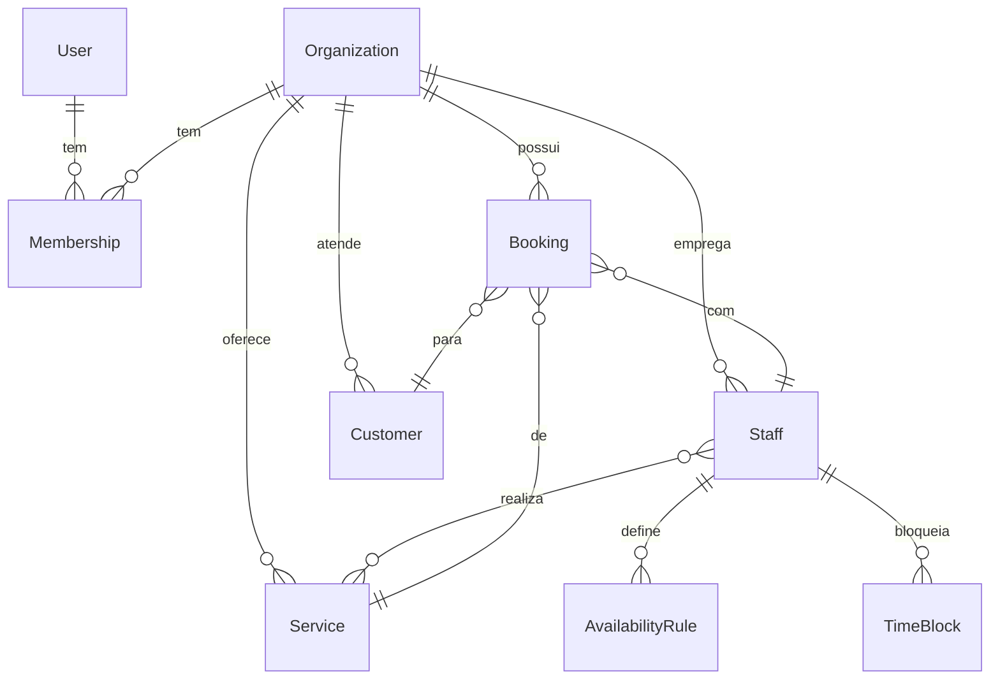

# AgendaFlow AI

SaaS de agendamento para barbearias e profissionais de beleza. Os clientes reservam por uma página pública, sem criar conta, e o dono acompanha agenda e indicadores num painel.

> **Status: Fase 2 (fundação) concluída.** Cadastro, login, criação de negócio e rotas protegidas funcionam. Serviços, agenda, página pública, assinaturas e IA ainda **não** foram implementados. Veja o [roadmap](#roadmap).

## Stack
Next.js (App Router) · React · TypeScript · Tailwind CSS · PostgreSQL · Prisma · Better Auth · Zod · Vitest

## Como rodar
Requisitos: Node 22+ e Docker **ou** o banco embutido do projeto.

```bash
npm install
cp .env.example .env        # preencha BETTER_AUTH_SECRET (openssl rand -base64 32)
docker compose up -d        # ou: npm run db:dev (PostgreSQL embutido, sem Docker)
npx prisma migrate dev
npm run dev
```

## Testes
```bash
npm test            # unitários e integração (precisa do banco rodando)
npm run lint && npm run typecheck && npm run build
```
Hoje cobrem: geração de slug, criação de organização, e **prevenção de reservas duplicadas** (20 reservas simultâneas no mesmo horário: só 1 é aceita).
Ainda não existem: testes E2E (Playwright) e testes de isolamento entre empresas (dependem da camada de dados da Fase 3).

## Decisões de arquitetura
- **Monólito modular**: `src/modules/<dominio>` com `actions` (entrada), `service` (regra de negócio), `schema` (Zod).
- **Multi-tenant**: toda tabela de negócio tem `organizationId`. O id da organização vem sempre da sessão no servidor (`requireOrg()`), nunca do cliente.
- **Sem reserva duplicada**: *exclusion constraint* do PostgreSQL por profissional (`prisma/migrations/*booking_no_overlap`). A garantia é do banco, então vale sob concorrência.
- **Horários em UTC**, com o fuso da organização guardado à parte (`America/Sao_Paulo` por padrão).
- **Valores em centavos** (inteiros).

## Modelo de dados


## Roadmap
- [x] Fase 1: planejamento
- [x] Fase 2: fundação (auth, organização, banco, CI)
- [ ] Fase 3: serviços, profissionais, disponibilidade, agenda, página pública, dashboard
- [ ] Fase 4: testes E2E, segurança, acessibilidade
- [ ] Fase 5: landing, assinaturas, deploy
- [ ] Fase 6: IA
- [ ] Fase 7: documentação final e demonstração

## Licença
Código-fonte disponível para avaliação, **não** livre para uso comercial. Veja [LICENSE](LICENSE).
